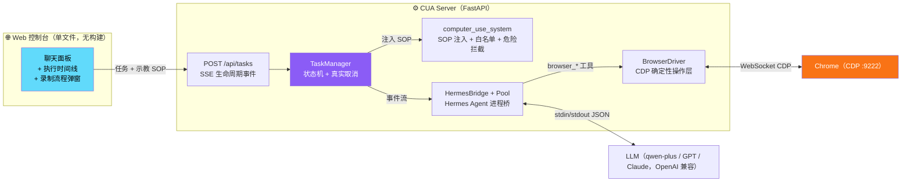
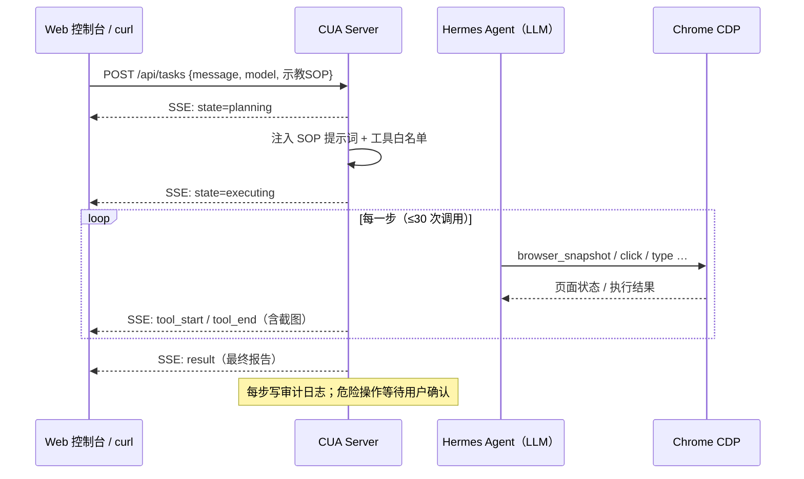
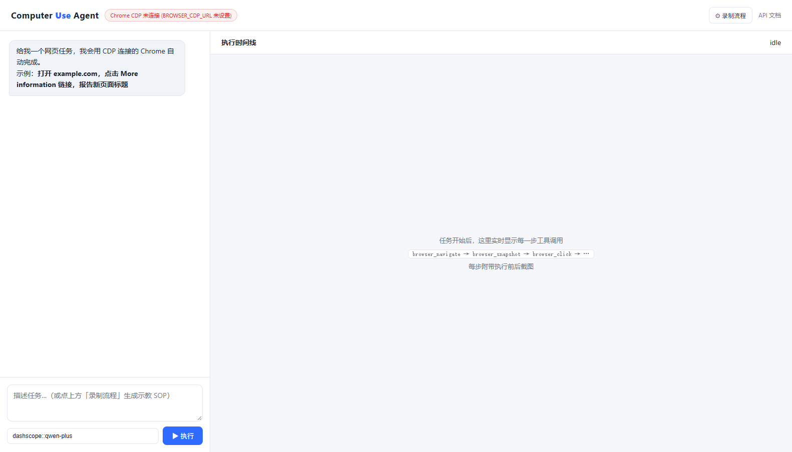

<div align="center">

# 🖥️ Computer Use Agent

**Teach once, replay forever — 可示教回放的网页自动化 Agent（CDP + Hermes 双执行层）**

[](https://github.com/NousResearch/hermes-agent)
[%20%2B%20Apache--2.0%20(this%20repo)-green)](LICENSE)
[](#-quick-start)
[](#-web-console)
[](https://chromedevtools.github.io/devtools-protocol/)

</div>

---

**Computer Use Agent** 是一个「示教回放」式网页自动化工具：把你在页面上要做的操作登记为步骤（录制流程），生成示教 SOP，Agent 就按录制的流程自动执行任务——元素找不到时用页面快照重新定位，遇到验证码暂停，每一步留截图与审计。

浏览器工具面与桌面 computer_use 工具集来自 [Hermes Agent](https://github.com/NousResearch/hermes-agent)（MIT 开源）；本仓库的服务端（任务状态机、CDP 驱动、进程桥、安全约束）与 Web 控制台为原创实现。

## ✨ 一分钟看懂

```text
录制流程                      Agent 按流程执行
──────────────               ──────────────────────
1. 打开页面 example.com       browser_navigate(example.com)
2. 点击「More information」 →  browser_snapshot (页面快照)
3. 报告新页面标题              browser_click(「More information」)
                              browser_snapshot → 提取标题 → 报告
```

- **示教步骤**写进 Agent 的系统提示词（SOP），失败自动重定位，不用改代码
- **每任务独立标签页**：TabBinding 给每个任务绑一个专属标签，互不干扰
- **每步留痕**：工具调用前后截图 + 审计日志，事后可回放检查
- **危险操作拦截**：URL/参数含 `支付/删除/确认/submit` 等关键词 → 强制人工确认；单任务最多 30 次工具调用
- **确定性回放**：录制的流程可零 LLM 确定性重放；单步失败按置信度多策略自愈，连续 3 步失败触发看门狗（刷新页面 + LLM 重规划）
- **定时哨兵**：「录一次，天天跑」——录制应用可挂定时计划，自动触发执行，结果落库可查
- **预置金融场景**：内置 7 个金融场景模板（港股行情 / 基金净值 / 新股申购 / 公告监控 / A股涨幅榜 / 北向资金 / 研报聚合）

## 🏛️ 架构



## 📦 目录结构

```text
Computer-Use-Agent/
├── server/                       ⚙️ 独立服务端（原创，Apache-2.0）
│   ├── cua_server/
│   │   ├── app.py                FastAPI 装配（/api/tasks + /health + Web 控制台）
│   │   ├── routes/browser_task.py 任务 API：创建(SSE)/查询/订阅/取消/审计 + 🎙️录制 start/peek/stop
│   │   │                          + ▶️回放 replay + 🖥️实时画面 view + 交互 interact
│   │   ├── services/
│   │   │   ├── task_manager.py   状态机 queued→planning→executing→waiting_user→done
│   │   │   ├── task_policy.py    审计日志 + 每任务标签页绑定（TabBinding）
│   │   │   ├── computer_use_system.py  SOP 提示词 + 工具白名单 + 危险操作拦截 + 30 次上限
│   │   │   ├── teach_recorder.py 🎙️ 示教录制器：注入钩子捕获 click/fill/select → sendBeacon 上报 → 生成 SOP + 回放命令
│   │   │   ├── replay_engine.py  ▶️ 确定性回放引擎（零 LLM）+ 置信度多策略自愈 + 看门狗
│   │   │   ├── sentinel_scheduler.py ⏰ 「录一次，天天跑」定时调度（独立 SQLite 存储）
│   │   │   ├── browser_driver.py CDP 确定性驱动（健康检查/标签页/导航/截图/断线重试）
│   │   │   ├── hermes_bridge.py  Hermes 进程桥（stdin/stdout JSON 协议）
│   │   │   ├── hermes_pool.py    进程池（会话隔离、空闲回收、崩溃重建）
│   │   │   └── model_config.py   模型凭据解析（env / providers.json）
│   │   ├── utils/logger.py       loguru 日志
│   │   └── web/index.html        🌐 极简控制台（零依赖单文件）
│   └── requirements.txt
├── webapp/                       🌐 完整 Web 应用前端（React + AntD，1,937 行）
│   ├── AgentComputerUse.tsx      会话管理 + 场景卡片 + 实时浏览器画面 + 执行时间线 + 录制面板 + 回放库
│   └── AgentComputerUse.css      浅色主题样式
├── hermes-agent/                 🔧 browser/computer_use 工具链源码（MIT, 上游摘录）
├── demo/                         🧪 最小 CDP 闭环（无服务端依赖的冒烟形态）
├── docs/
│   ├── architecture.md           设计决策与代价、已知限制
│   └── screenshots/              Web 控制台与 demo 运行截图
├── NOTICE.md                     溯源声明（上游代码 vs 本仓库原创）
└── README.md
```

## 🚀 Quick Start

### 前置

- Python ≥ 3.11、Chrome
- 一个 OpenAI 兼容模型端点（qwen-plus / deepseek / GPT / Claude 均可）

### 1. 配置模型凭据（二选一）

```bash
# 方式 A：环境变量（单 provider）
export CUA_MODEL_KEY="dashscope::qwen-plus"
export CUA_PROVIDER_DASHSCOPE_API_KEY="sk-..."

# 方式 B：providers.json（多 provider）
cat > server/cua_server/services/providers.json <<'EOF'
{
  "dashscope": {
    "name": "DashScope",
    "apiUrl": "https://dashscope.aliyuncs.com/compatible-mode/v1",
    "apiKey": "sk-..."
  }
}
EOF
```

### 2. 启动 Chrome（CDP 模式）+ 服务

```bash
chrome --remote-debugging-port=9222 --user-data-dir=/tmp/cua-chrome

cd server
export BROWSER_CDP_URL="http://127.0.0.1:9222"
pip install -r requirements.txt
uvicorn cua_server.app:app --host 0.0.0.0 --port 8000
```

### 3. 打开控制台

浏览器访问 `http://localhost:8000/` → 输入任务（或点「⚙︎ 录制流程」生成示教 SOP）→ ▶ 执行，右侧实时看到每一步工具调用与截图。

### 也可以不用控制台（curl / SSE）

```bash
# 创建任务（返回 SSE 事件流）
curl -N -X POST http://localhost:8000/api/tasks \
  -H "Content-Type: application/json" \
  -d '{"message":"打开 example.com，点击 More information，报告新页面标题","model":"dashscope::qwen-plus"}'

# 取消 / 查询 / 审计
curl -X POST http://localhost:8000/api/tasks/<id>/cancel
curl http://localhost:8000/api/tasks/<id>
curl http://localhost:8000/api/tasks/<id>/audit
```

## 🔄 任务生命周期



## 🖥️ Web 控制台



- **左侧**：任务对话（示教 SOP 与最终报告）
- **右侧**：执行时间线——每步工具名、参数、结果、执行后截图，实时滚动
- **录制流程**：弹窗里按「动作 / 目标 / 内容」登记步骤，一键生成示教 SOP 填入任务
- 顶栏实时显示 Chrome CDP 连接状态

## 🛡️ 安全机制

| 环节 | 措施 |
|---|---|
| 危险操作拦截 | URL/选择器含 `delete/remove/支付/删除/确认/提交` 等 → 等待用户确认 |
| 金融交易保护 | 提示词硬约束：「不要在表单中自动提交涉及金融交易的表单」 |
| 调用上限 | 单任务 30 次工具调用，超限任务置 FAILED（防失控循环） |
| 重试上限 | 单步失败最多重试 3 次后报告错误 |
| 任务隔离 | 每任务独立标签页（TabBinding），结束即关闭；Hermes 会话按指纹隔离 workspace |
| 审计日志 | 每次工具调用（含参数/耗时/结果）入 AuditLogger，`GET /api/tasks/{id}/audit` 可查 |
| 验证码 | 检测到验证码/登录页 → 进入 `waiting_user`，暂停并告知 |

## 🧪 示教回放实录（生产验证数据）

以下为本工具的真实运行记录（已脱敏还原到 `demo/`）：

```text
示教步骤  1. 点击「搜索关键词」（#kw）
         2. 在输入框填入：北向资金        ← 金融场景示例
         3. 点击「提交」（#go）
断言      #out === "submitted:北向资金"
执行模型  qwen-plus · 结果 path_ok · 全程轨迹 JSON 落盘
```

## 📚 文档

| 文档 | 内容 |
|---|---|
| [docs/architecture.md](docs/architecture.md) | 设计决策与代价、可访问性树 vs 纯视觉路线对比、已知限制 |
| [demo/README.md](demo/README.md) | 最小 CDP 闭环与轨迹格式 |
| [NOTICE.md](NOTICE.md) | 溯源声明：Hermes 上游代码 vs 本仓库原创的边界 |

## 🙏 上游与许可

- **浏览器/桌面工具链**：[NousResearch/hermes-agent](https://github.com/NousResearch/hermes-agent) v0.16.0（MIT）——`hermes-agent/` 目录为其 wheel 内相关模块的原样摘录，未做修改；桌面 computer_use 依赖 [trycua/cua](https://github.com/trycua/cua)（MIT）
- **服务端与 Web 控制台**（`server/`）：本仓库原创，Apache-2.0
