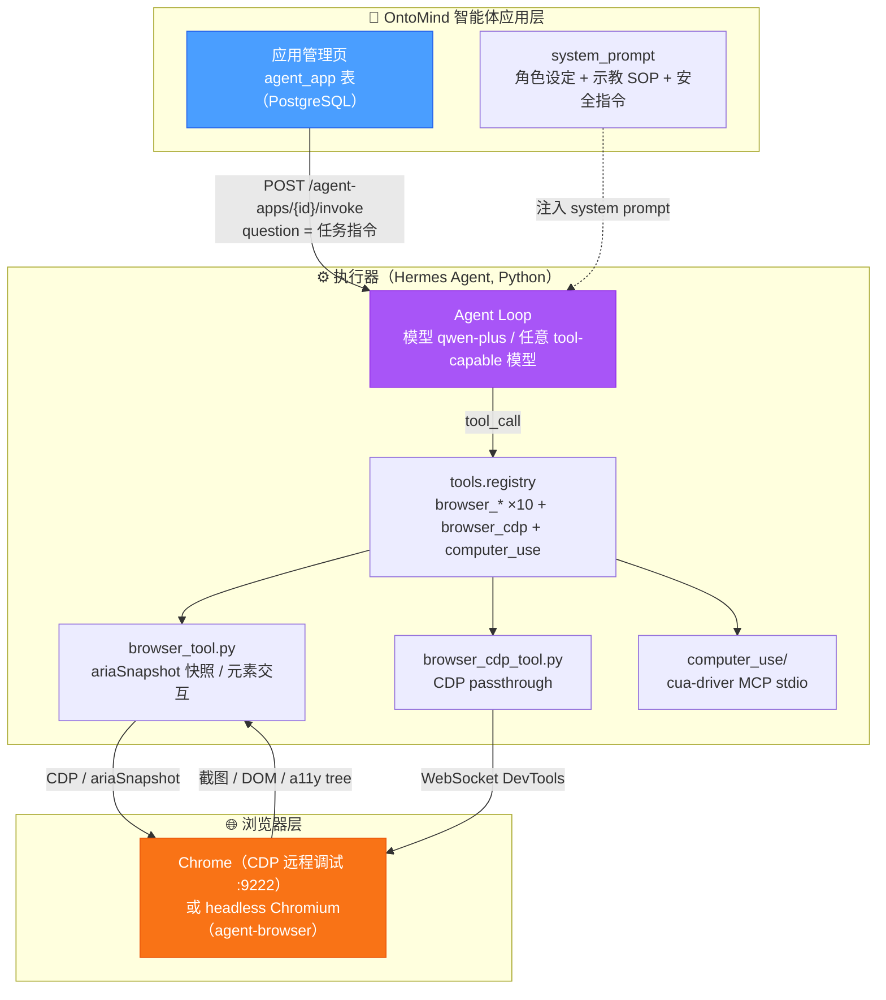
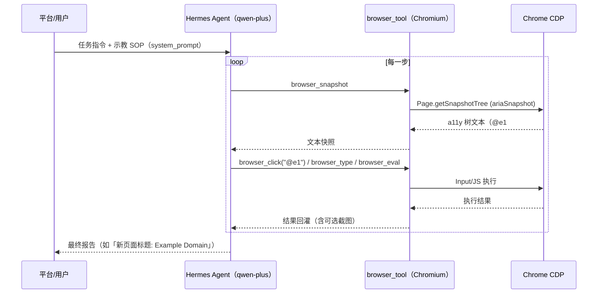

<div style="text-align:center">

# 🖥️ Computer Use Agent

**基于 Hermes Agent browser/computer_use 工具闭环的网页自动化智能体 —— OntoMind 智能体应用的生产实录与集成方案**

[](https://github.com/NousResearch/hermes-agent)
[%20%2B%20Apache--2.0%20(integration)-green)](LICENSE)
[](https://chromedevtools.github.io/devtools-protocol/)
[](hermes-agent/tools/browser_tool.py)

</div>


---

> **Computer Use Agent** 是一个通过「可访问性树快照 → 工具调用 → 再观察」闭环操控网页的智能体应用。它在本体平台（OntoMind）里注册为 `COMPUTER_USE` 类型的 AgentApp，底层执行器复用 [Nous Research 的 Hermes Agent](https://github.com/NousResearch/hermes-agent) 的 `browser_*` 与 `computer_use` 工具集（MIT 开源）。本仓库包含三个东西：**①** 执行器相关源码的整包摘录（带溯源声明）；**②** 生产环境 `agent_app` 表中 5 条 `COMPUTER_USE` 记录的完整还原（system_prompt、示教 SOP、闭环测试页面）；**③** 一个不依赖平台、clone 后 4 行命令可跑的 CDP 闭环 demo。

## 📑 目录

- [✨ 核心特性](#-核心特性)
- [🏛️ 总体架构](#️-总体架构)
- [📦 目录结构](#-目录结构)
- [🚀 快速开始](#-快速开始)
- [🔄 执行闭环](#-执行闭环)
- [🧩 核心组件](#-核心组件)
- [📡 browser 工具面](#-browser-工具面)
- [🔒 安全机制](#-安全机制)
- [🧪 闭环测试实录](#-闭环测试实录)
- [📚 文档](#-文档)
- [🙏 上游与许可](#-上游与许可)

---

## ✨ 核心特性

| 特性 | 说明 |
|:---:|---|
| 🌐 | **可访问性树优先** — `browser_snapshot` 返回 ariaSnapshot 文本快照，LLM 按 `@e1`/`@e2` 元素引用交互，不靠像素坐标，对无视觉能力的模型同样可用 |
| 🖱️ | **双工具面** — 网页任务走 `browser_*`（headless Chromium，更可靠）；原生桌面任务走 `computer_use`（cua-driver 后台驱动，不抢占用户光标与焦点） |
| 🔄 | **观察-决策-执行闭环** — 每一步先 snapshot 观察页面状态再决定下一个动作，元素找不到时重新定位相似元素继续 |
| 🧑‍🏫 | **示教回放（Teach & Replay）** — 用户示教一遍操作步骤（选择器序列），智能体按 SOP 顺序回放，某步失败时自动重定位 |
| 🛡️ | **分层安全** — `computer_use` 侧有 approval 审批回调、危险按键组合硬黑名单（登出/锁屏/清空废纸篓）、危险文本模式拦截；浏览器侧有 CDP 白名单与 URL 安全检查 |
| 🧪 | **闭环可测** — 附带生产环境真实跑通的闭环测试记录：data: URL 页面 → 选择器 #kw 输入 → #go 提交 → 断言输出文本 |
| 🔌 | **CDP 透传** — `browser_cdp` 工具可发任意 [Chrome DevTools Protocol](https://chromedevtools.github.io/devtools-protocol/) 命令，覆盖主工具面未及的原生弹窗、iframe 求值、Cookie/网络控制 |

## 🏛️ 总体架构



**流量说明**：平台前端调用 `POST /api/v1/agent-apps/app-computer-use/invoke`，服务端组装 system_prompt（角色 + 示教 SOP + 安全边界）与用户任务，交给 Hermes Agent 循环。Agent 每轮先 `browser_snapshot` 拿文本快照，模型基于快照产出下一个工具调用（click/type/eval），执行结果回灌，直到任务完成或触发暂停条件（验证码/需人工干预）。

## 📦 目录结构

```text
Computer-Use-Agent/
├── hermes-agent/                  ⚙️ 执行器源码摘录（MIT, Nous Research，v0.16.0 原样未改）
│   ├── tools/
│   │   ├── computer_use/          🖥️ 通用桌面操控工具集（6 文件 2,147 行）
│   │   │   ├── backend.py         抽象后端接口（capture/click/drag/scroll/type/key）
│   │   │   ├── cua_backend.py     默认后端：MCP stdio → cua-driver
│   │   │   ├── schema.py          model-agnostic 工具 schema
│   │   │   ├── tool.py            注册入口 + 审批闸门 + 危险操作黑名单
│   │   │   └── vision_routing.py  截图 → 视觉模型路由决策
│   │   ├── browser_tool.py        🌐 browser_* 工具面（3,863 行，10 个工具）
│   │   ├── browser_cdp_tool.py    🔌 CDP 透传工具（569 行）
│   │   ├── browser_supervisor.py  浏览器进程/会话管理（1,475 行）
│   │   └── registry.py            工具注册中心
│   ├── agent/browser_*.py         浏览器 provider 抽象与注册表
│   ├── hermes_cli/browser_connect.py   `/browser connect` CLI
│   ├── plugins/browser/           browser-use / Browserbase / Firecrawl 云后端插件
│   ├── LICENSE                    上游 MIT 许可证原文
│   └── UPSTREAM-METADATA.txt      wheel METADATA（版本/依赖溯源）
├── ontomind-app/                  📱 平台集成层（自研）
│   ├── apps/                      生产 agent_app 表 COMPUTER_USE 记录还原（JSON）
│   └── migrations/                agent_app 表 DDL + COMPUTER_USE 种子 SQL
├── demo/                          🧪 4 行命令可跑的闭环 demo（无平台依赖）
├── docs/
│   ├── architecture.md            设计决策与代价、已知限制
│   └── screenshots/               运行截图
├── NOTICE.md                      溯源声明：哪些代码来自上游、哪些是自研
└── README.md
```

## 🚀 快速开始

### 前置条件

- Python ≥ 3.11
- Chrome / Chromium（本机安装即可）
- 一个 OpenAI 兼容的模型端点（qwen-plus / deepseek / GPT / Claude / 本地 vLLM 均可）

### 方式一：闭环 demo（不依赖平台，最快验证）

```bash
git clone https://github.com/wanshoulu/Computer-Use-Agent.git
cd Computer-Use-Agent/demo
pip install -r requirements.txt
python run_demo.py --cdp-port 9222     # 详见 demo/README.md
```

Demo 会：启动带 CDP 的 Chrome → 打开内置测试页 → `browser_snapshot` → 按示教 SOP 依次点击 `#kw`、输入、点 `#go` → 断言 `#out` 文本变为 `submitted:...` → 输出全程轨迹 JSON。

### 方式二：作为 Hermes 工具集使用（完整能力）

```bash
# 安装 Hermes Agent（上游官方脚本）
curl -fsSL https://hermes-agent.nousresearch.com/install.sh | bash

# 启用 browser 工具集 + 连接本机 Chrome 的 CDP
hermes tools          # 交互式勾选 Browser / Computer Use
/browser connect http://localhost:9222

# 跑一个 computer-use 任务
hermes -t browser chat "打开 example.com，报告页面标题"
```

### 方式三：注册到 OntoMind 平台（AgentApp 形态）

```bash
psql -h <host> -U ontomind -d ontomind -f ontomind-app/migrations/V53__add_agent_apps.sql
psql -h <host> -U ontomind -d ontomind -f ontomind-app/migrations/V56__extend_for_manifests.sql
psql -h <host> -U ontomind -d ontomind -f ontomind-app/migrations/seed_computer_use_apps.sql
```

注册后，「智能体应用 → 应用管理」出现 **Computer Use Agent** 卡片，前端调用 `POST /api/v1/agent-apps/app-computer-use/invoke` 即可下发任务。

## 🔄 执行闭环



**关键设计**：快照是**文本**不是截图 —— ariaSnapshot 的 `@eN` 元素引用让点击由索引驱动，比「截图 → 视觉模型算坐标 → 点击」的纯视觉路线更稳、更省 token。视觉能力保留在 `browser_vision`（单页截图分析）与 `computer_use`（原生桌面 SOM 截图）里，按需取用。

## 🧩 核心组件

| 组件 | 行数 | 技术栈 | 职责 |
|---|:---:|---|---|
| `browser_tool.py` | 3,863 | Python | browser_* 10 工具：navigate/snapshot/click/type/scroll/back/press/get_images/vision/console；三后端（local Chromium / Browserbase / Browser Use cloud）自动探测 |
| `browser_cdp_tool.py` | 569 | Python + websockets | `browser_cdp` 透传任意 CDP 命令（原生弹窗、iframe 求值、Cookie/网络、Tab 管理） |
| `browser_supervisor.py` | 1,475 | Python | Chromium 进程生命周期、每任务会话隔离、自动清理 |
| `computer_use/` | 2,147 | Python + MCP | 桌面操控工具集：MCP stdio → cua-driver；SOM 截图（编号覆盖层）+ AX 树；审批回调 |
| `plugins/browser/` | 6 文件 | Python | 云浏览器插件：browser-use / Browserbase / Firecrawl |
| `apps/*.json` | — | JSON | 生产 COMPUTER_USE 应用记录（system_prompt 实录） |
| `migrations/*.sql` | — | SQL | agent_app 表 DDL 与种子数据 |

## 📡 browser 工具面

| 工具 | 作用 | 典型用法 |
|---|---|---|
| `browser_navigate` | 打开 URL | `browser_navigate("https://example.com", task_id=...)` |
| `browser_snapshot` | 取 ariaSnapshot 文本快照 | 每步先调用，拿到 `@eN` 元素索引 |
| `browser_click` | 点击元素 | `browser_click("@e5")`（按 ref）或按文本 |
| `browser_type` | 输入文本 | 配合 click 聚焦输入框 |
| `browser_scroll` | 滚动页面 | 上/下/左/右 |
| `browser_press` | 按键 | Enter / Tab / Escape |
| `browser_back` | 后退 | 历史回退 |
| `browser_get_images` | 提取图片 | 按条件过滤 |
| `browser_vision` | 视觉分析 | 截图 → 视觉模型 → 文本描述 |
| `browser_console` | 读控制台 | 调试 JS 报错 |
| `browser_eval` | JS 求值 | 常规点击不生效时的兜底（生产 prompt 明示） |
| `browser_cdp` | CDP 透传 | 任意 DevTools Protocol 命令 |
| `computer_use` | 桌面操控 | capture(som)/click(element=N)/type/key/…，走 cua-driver |

## 🔒 安全机制

| 环节 | 措施 |
|---|---|
| 审批闸门 | `computer_use` 破坏性动作（click/type/key/…）默认走 approval 回调，返回 `approve_once / approve_session / always_approve / deny`；`capture/wait/list_apps` 免审批 |
| 按键黑名单 | 硬拦截 `Cmd+Shift+Backspace`（清空废纸篓）、`Cmd+Ctrl+Q`（锁屏）、`Cmd+Shift+Q`（登出）等，无论审批级别 |
| 文本拦截 | `type` 动作带危险文本模式检查（fork bomb 等） |
| Prompt 级 | 生产 system_prompt 明示：「遇到验证码或需要人工干预时暂停并告知用户」「先 snapshot 再行动」 |
| 平台授权 | AgentApp 走 Bearer 令牌 + 知识清单 Manifest 激活校验，未授权应用不可 invoke |
| URL 安全 | `tools/url_safety.py` 与 CDP 白名单校验目标地址 |

## 🧪 闭环测试实录

生产 `agent_app` 表中留有 3 条闭环测试记录（`闭环测试-1794058473` 等），真实跑通的数据已还原到 `demo/`：

```text
起始页   data:text/html;charset=utf-8,...（内置测试页，见 demo/demo-page.html）
SOP      1. 点击 #kw   2. 输入文本   3. 点击 #go
断言     #out 文本 === "submitted:<输入内容>"
```

测试页极简：一个输入框 + 一个把输入回显到 `#out` 的按钮 —— 专门用来验证「snapshot → 选择器定位 → 交互 → 断言」全链路，不依赖外网。

## 📚 文档

| 文档 | 内容 |
|---|---|
| [docs/architecture.md](docs/architecture.md) | 设计决策与代价、与纯视觉 CUA 路线的对比、已知限制 |
| [demo/README.md](demo/README.md) | 闭环 demo 的运行细节与轨迹输出格式 |
| [NOTICE.md](NOTICE.md) | 溯源声明：上游代码 vs 自研代码的边界 |

## 🙏 上游与许可

- **执行器源码**：[NousResearch/hermes-agent](https://github.com/NousResearch/hermes-agent) v0.16.0（MIT License，Copyright (c) 2025 Nous Research）。本仓库 `hermes-agent/` 目录为其 wheel 内相关模块的**原样摘录**（未做任何修改），仅收录 Computer Use / Browser 工具链涉及的文件，完整发行版请使用上游官方安装脚本。
- **桌面驱动**：[trycua/cua](https://github.com/trycua/cua)（cua-driver）—— `computer_use` 工具集通过 MCP stdio 对接的开源后台桌面操控驱动。
- **平台集成层**（`ontomind-app/`、`demo/`）：本仓库自研，Apache-2.0。
- 生产系统：AI Harbor · OntoMind 智能体平台。
